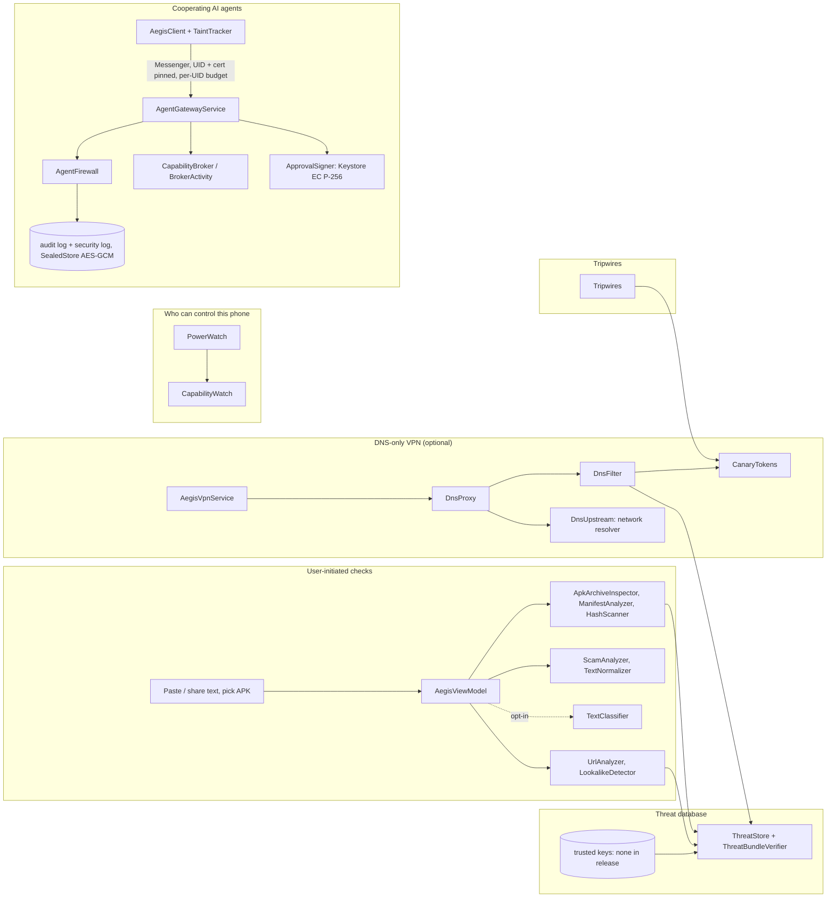

# Architecture — 0.8.1-rc12 (internal test build)

Regenerated on 2026-10-28 from the source tree (replaces the 0.7.3-rc4 version). For what has and has not been verified, see TEST_RESULTS.md; the full component audit is in the 2026-10-27 security audit (kept outside this repository).

**Status in one line: the pure-Java modules are host-tested; nothing on the Android side has run on a device or emulator.**

## Modules
| Module | Kind | Contents |
|---|---|---|
| `core` | Java 17 library, no dependencies, API-26-safe | analysers, DNS filter and proxy, threat database, agent firewall, broker, capability watch logic, canary tokens |
| `app` | Android app (Kotlin, Compose), `com.aegis.aishield` | UI, Android adapters (VPN service, gateway service, power watch, tripwires, Keystore storage and signing) |
| `agent-sdk` | Java 17 library, no dependencies | agent protocol constants, action fingerprints, harness-side provenance (`TaintTracker`), approval tokens and verifier, CLI |
| `agent-sdk-android` | Android library | `AegisClient`: finds and binds Aegis, request ids, broker launch |
| `sample-agent` | Android app, `com.aegis.sampleagent` | demo harness for the SDK (no AI model; sends nothing itself) |

There is no native code. Permissions (app): INTERNET, ACCESS_NETWORK_STATE, FOREGROUND_SERVICE, FOREGROUND_SERVICE_SYSTEM_EXEMPTED, POST_NOTIFICATIONS; `<queries>` for six system-service intent actions. Pinned by `tools/check_privacy.py`.

## Components

## Data flows
- **Checks:** explicit paste/share → bounded input → deterministic analysis → typed verdict and findings → localised text. APK: document picker → private temporary copy → archive preflight → SHA-256 → Android metadata → signer digests and manifest heuristics → temporary file deleted. No APK code runs; only the manifest is analysed. No scan history is kept.
- **DNS protection:** the VPN routes only two virtual resolver addresses (IPv4 and IPv6). Queries are decided locally (tripwire names first, then the user's lists, protected names and the threat database) and answered NXDOMAIN when blocked; the rest are forwarded unencrypted (UDP, TCP on truncation) to the current network's resolver over a protected, network-bound socket. Counters and the last 200 blocked/warned names are kept in memory only. Fails open. It is not restarted after a reboot unless Android's Always-on VPN is set.
- **Power watch:** reads Accessibility, notification-listener, device-admin, default-SMS, input-method holders and whether some VPN is active; diffs against a baseline the person reviewed; notifies about new grants. Runs when Aegis comes to the front and every 30 minutes while DNS protection runs.
- **Tripwires:** decoy contact/note/file planted through the system's own Contacts, share and document screens; each carries a random token under `aegis-canary.invalid`; a lookup of it is blocked, recorded and alerted.
- **Agent gateway:** exported Messenger service. Per-UID message budget (120/min) before any lookup; caller identified by `sendingUid` and pinned signing certificate; kill switch refuses everything first. The firewall decides ALLOW / ASK_USER / DENY (rate limit 30/min, secret/PII/injection scans, exact-host trust, provenance that can turn a refusal into a question but never a question into a silent allow). Approvals are bound to a hash of the exact request, single-use, 5 minutes. Brokered actions (open an https link, share text) are carried out by Aegis itself. ALLOW and granted redemptions carry a signed, 120-second approval token for the destination server.
- **Agent logs:** a main audit log (500 entries) and a separate security log (300 entries: pairings, the person's answers, kill switch, log damage, rate-limit hits), each SHA-256 hash-chained, stored with AES-256-GCM under a Keystore key. Denials are logged individually up to 5 per agent per minute and otherwise summarised, so flooding cannot rotate the log or force writes. Saves happen only when state changed, at most once per 2 s for gateway traffic.

## Trust boundaries
- shared text and picked documents (untrusted content)
- hostile archives
- Android's package parser
- DNS packets from apps
- upstream DNS responses
- threat bundles (signature, sequence floor, size limits)
- every Bundle sent to the gateway (untrusted until the caller is pinned; the agent's text is shown as its claim)
- approval tokens (verified by servers, never trusted by Aegis)

A rejection never means "malicious", and "no warning signs" never means "safe".

## What does not exist
- no scanning of installed apps or monitoring of app updates
- no correlation of events across modules, and no device-wide risk score
- no root, integrity, overlay-holder, install-source or developer-options checks
- no per-app network attribution
- no beaconing or traffic-volume analysis
- no production threat-feed signing key or feed
- no network calls from the app other than forwarding DNS

These gaps and their priorities are listed in the 2026-10-27 audit.
